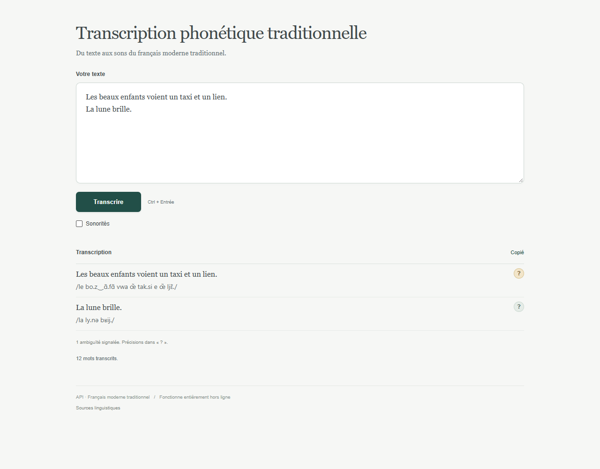
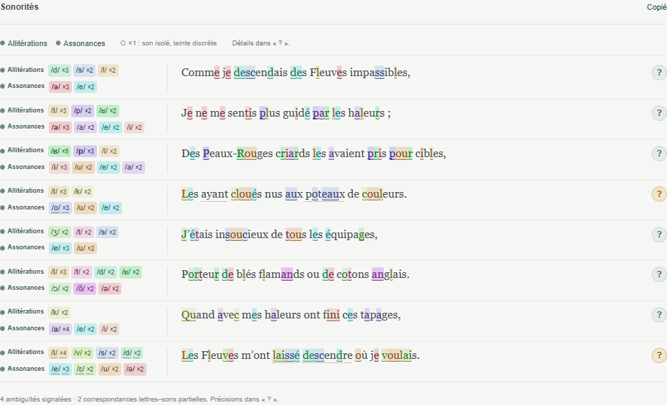
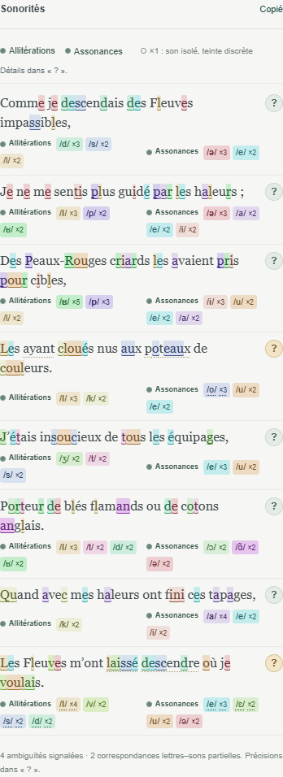

# Transcription phonétique traditionnelle

**Du texte aux sons du français moderne traditionnel.**  
**From French text to traditional modern French sounds.**

Une application autonome de transcription en alphabet phonétique international (API), avec une vue des allitérations et des assonances pour explorer la matière sonore des textes. Un seul fichier HTML, utilisable entièrement hors ligne.

A standalone International Phonetic Alphabet (IPA) transcription app, with an alliteration and assonance view for exploring the sounds of French texts. One self-contained HTML file, fully usable offline.

**[Français](#français)** · **[English](#english)** · **[Contribuer / Contributing](CONTRIBUTING.md)** · **[Signaler un problème / Report an issue](https://github.com/Heroless-code/Transcription-phonetique-traditionnelle/issues)**

## Aperçu / Screenshots

### Transcription ligne par ligne / Line-by-line transcription



### Allitérations et assonances / Alliteration and assonance



<details>
<summary>Vue mobile / Mobile view</summary>



</details>

Captures de la v2 incluse dans ce dépôt ; l'interface actuelle est en français.  
Screenshots of the v2 included in this repository; the current app interface is in French.

## Français

### Présentation

**Transcription phonétique traditionnelle** convertit un mot, un groupe de mots, une phrase ou un texte en API. Chaque ligne originale reste visible au-dessus de sa transcription, dans une interface épurée. Le mode **Sonorités** aide à observer les répétitions de consonnes et de voyelles, avec des décomptes par vers et des surbrillances dans le texte.

Le projet s'adresse notamment aux personnes qui écrivent, lisent ou étudient la poésie, aux enseignants et aux lecteurs qui souhaitent examiner la prononciation et les sonorités du français.

La cible est le [français moderne traditionnel du Wiktionnaire](https://fr.wiktionary.org/wiki/Annexe:Prononciation/fran%C3%A7ais#Fran%C3%A7ais_moderne_traditionnel). L'application conserve des oppositions traditionnelles et les longueurs lexicales retenues. La version actuelle applique une **lecture classique**, avec traitement des e caducs, élisions et variantes de diérèse/synérèse. Elle n'impose aucun mètre au texte.

### Fonctionnalités

| Fonction | Comportement |
| --- | --- |
| Transcription API | Texte ligne par ligne, avec l'API en dessous ; ponctuation et lignes vides conservées. |
| Lexique embarqué | 1 632 485 graphies, complétées par des règles de morphologie et de contexte. |
| Contexte | Cas reconnus de liaisons obligatoires, homographes, nombres et h disjonctifs ; liaisons facultatives omises. |
| Sonorités | Répétitions de phonèmes, allitérations et assonances comptées par ligne. |
| Filtres | Contrôles globaux ou par vers ; affichage facultatif des sons isolés « ×1 ». |
| Précisions « ? » | Variantes de lecture, hypothèses et limites ; certains choix sont propres à chaque occurrence. |
| Copier l'API | Copie de la transcription, même lorsque le mode Sonorités masque sa ligne. |
| Autonomie | Sans compte, serveur, installation ou connexion après téléchargement. |

### Installation : un fichier à ouvrir

1. Sur la page du dépôt, cliquer sur **Code**, puis **Download ZIP**.
2. Extraire l'archive dans le dossier de votre choix.
3. Ouvrir **`Transcription-phonetique-traditionnelle.html`** avec un navigateur récent. Si nécessaire : clic droit, **Ouvrir avec**, puis votre navigateur.
4. Attendre la fin de l'initialisation du lexique, puis saisir votre texte.

Le fichier HTML contient l'interface, le moteur et les données nécessaires. Vous pouvez le conserver seul et le copier sur un autre ordinateur. `index.html` et `dist/index.html` sont des copies identiques de cette version. **Node.js et les outils de développement ne sont pas nécessaires pour utiliser l'application.**

### Tutoriel d'utilisation

#### 1. Transcrire un texte

Coller ou saisir un texte dans **Votre texte**, en conservant un retour à la ligne par vers pour un poème. Par exemple :

```text
Les enfants jouent dans le jardin.
La lune brille.
```

Cliquer sur **Transcrire**, ou utiliser **Ctrl + Entrée**. Les lignes originales apparaissent avec leur API en caractères plus petits en dessous. Les lignes vides restent des séparations. Utiliser **Copier l'API** pour récupérer la transcription.

#### 2. Observer les sonorités

Cocher **Sonorités** après transcription. L'API est masquée pour laisser une vue compacte du texte, des sons et de leurs répétitions. Décocher l'option réaffiche la même transcription.

- **Allitérations** regroupe les consonnes, avec les semi-voyelles ; **Assonances** regroupe les voyelles orales et nasales.
- Les contrôles de la barre supérieure agissent sur tout le texte ; les titres près d'un vers agissent sur ce seul vers.
- Les pastilles indiquent les phonèmes et leur nombre d'occurrences. Des clics successifs mettent un son en évidence, masquent sa couleur, puis la rétablissent.
- Le bouton **×1** ajoute les sons isolés, masqués par défaut. Un son isolé n'est pas une répétition.

Les comptes reposent sur les sons prononcés retenus par le moteur. Une lettre muette ne constitue pas un son ; deux occurrences dans un même mot comptent comme deux occurrences. Une répétition repérée ne prouve pas, à elle seule, une intention littéraire.

#### 3. Consulter une ambiguïté

Cliquer sur **« ? »** à droite du vers pour consulter les notes et les variantes disponibles. Une teinte ambrée signale notamment une ambiguïté ou une hypothèse. Les choix de diérèse/synérèse sont proposés par occurrence ; les décomptes se recalculent après sélection. Fermer le panneau avec **Échap** ou un clic extérieur.

### Limites

L'application propose une lecture phonémique selon ses conventions. Les homographes exigeant une interprétation du sens, les noms propres, les emprunts récents, les mots inventés et les syntaxes complexes peuvent donner des résultats discutables. Un mot inconnu reçoit une hypothèse signalée. Certaines correspondances lettres–sons restent partielles et sans surbrillance.

La lecture classique est actuellement la seule lecture proposée. Le programme n'est ni un outil de synthèse vocale, ni une garantie de prononciation universelle, ni une analyse automatique définitive des figures littéraires. Consulter [les conventions linguistiques](docs/LINGUISTIQUE.md), [la lecture poétique](docs/LECTURE_POETIQUE.md) et [les sonorités](docs/SONORITES.md).

### Développement

Les sources sont dans `src/`, les outils dans `tools/`, les tests dans `tests/` et les rapports dans `validation/`. Le fonctionnement livré n'utilise aucune bibliothèque JavaScript d'exécution externe.

```sh
node tools/build.mjs --note "Description de la modification"
node tests/run.mjs
node tests/sonorities.mjs
node tests/poetry.mjs
node tests/sonority-palette.mjs
```

La génération des archives numérotées utilise PowerShell en développement. Les tests navigateur nécessitent Playwright. Certaines suites complètes et la reconstruction des données lexicales nécessitent des ressources externes absentes du dépôt : voir [GITHUB.md](GITHUB.md). Après génération, synchroniser `index.html` avec `dist/index.html`.

- [Documentation technique détaillée](README_TECHNIQUE.md)
- [Rapport de validation](RAPPORT_VALIDATION.md)
- [Historique des versions](HISTORIQUE_VERSIONS.md)
- [Règles de conservation des versions](AGENTS.md)

### Participer

Le dépôt est **public**. Vous pouvez ouvrir une [issue](https://github.com/Heroless-code/Transcription-phonetique-traditionnelle/issues), créer un fork et soumettre une [pull request](https://github.com/Heroless-code/Transcription-phonetique-traditionnelle/pulls). Les propositions sont examinées avant intégration. Les corrections de prononciation accompagnées de références, les améliorations de l'interface, de l'accessibilité et de la documentation sont bienvenues. Voir [CONTRIBUTING.md](CONTRIBUTING.md).

### Sources et attributions

Les ressources tierces conservent leurs conditions propres. [Lexique 4.1](https://www.lexique.org/), de Boris New, Christophe Pallier et collaborateurs, est adapté sous CC BY-SA 4.0 : voir [sa notice](data/references/LEXIQUE_ATTRIBUTION.md). Les ajouts issus de GLÀFF 1.2.2 sont documentés dans [l'attribution GLÀFF](data/references/GLAFF_ATTRIBUTION.md) et [sa notice originale](data/references/GLAFF_LISEZMOI.txt).

Le JSONL initial fourni pour le projet ne précise pas sa provenance complète ni sa licence ; cette limite est documentée. Aucune licence globale supplémentaire n'est attribuée à ces données par cette publication. Les notices intégrées au HTML sont conservées.

**Version provisoire :** cette publication correspond à la v2 actuelle. Le projet reste en développement ; des corrections, enrichissements et mises à jour pourront être proposés. Les résultats peuvent évoluer d'une version à l'autre.

---

## English

### Overview

**Transcription phonétique traditionnelle** converts French words, phrases, sentences or longer texts into IPA. Each original line appears above its transcription in a minimal interface. The **Sonorités** view helps explore repeated consonants and vowels through per-line counts and highlights in the original text.

The project is intended for people writing, reading or studying poetry, as well as teachers and readers interested in French pronunciation and sound patterns.

Its reference is the Wiktionary description of [traditional modern French](https://fr.wiktionary.org/wiki/Annexe:Prononciation/fran%C3%A7ais#Fran%C3%A7ais_moderne_traditionnel). It preserves selected traditional contrasts and documented lexical vowel lengths. The current version uses a **classical reading policy**, including schwa treatment, elision and available diaeresis/synaeresis variants. It does not force a poetic metre.

### Features

| Feature | Behaviour |
| --- | --- |
| IPA transcription | Original lines with smaller IPA underneath; punctuation and blank lines preserved. |
| Embedded lexicon | 1,632,485 spellings, supplemented by morphological and contextual rules. |
| Context | Recognized obligatory liaisons, homographs, numbers and disjunctive h; optional liaisons omitted. |
| Sound patterns | Repeated phonemes counted per line, separating alliteration from assonance. |
| Filters | Global and per-line controls; optional display of isolated “×1” sounds. |
| “?” details | Reading variants, hypotheses and limitations; choices for individual occurrences. |
| Copy IPA | Copies transcription even when its lines are hidden in the sound-pattern view. |
| Offline use | No account, server, installation or Internet connection needed after downloading. |

### Installation: open one file

1. On the repository page, select **Code → Download ZIP**.
2. Extract the archive to a folder of your choice.
3. Open **`Transcription-phonetique-traditionnelle.html`** in a recent browser. If needed, right-click and choose **Open with** your browser.
4. Wait for the lexicon to initialize, then enter French text.

The file contains the interface, engine and required data. You can keep just this HTML file and copy it to another computer. `index.html` and `dist/index.html` are byte-identical copies of this version. **Node.js and development tools are not needed to use the app.** The interface itself is currently in French; this README provides English guidance.

### Usage tutorial

#### 1. Transcribe text

Enter or paste French text into **Votre texte** (“Your text”). For a poem, keep one verse per line. For example:

```text
Les enfants jouent dans le jardin.
La lune brille.
```

Click **Transcrire** (“Transcribe”) or press **Ctrl + Enter**. Original lines appear with smaller IPA transcriptions underneath; blank lines remain separators. Use **Copier l'API** (“Copy IPA”) to copy the result.

#### 2. Explore sound patterns

Enable **Sonorités** after transcription. IPA lines are hidden to show a compact view of the original text, sounds and repetitions. Disabling the option restores the same transcription.

- **Allitérations** lists consonants, including semivowels; **Assonances** lists oral and nasal vowels.
- Controls in the top toolbar affect the entire text; labels beside a verse affect that verse only.
- Phoneme chips show occurrence counts. Successive clicks emphasize a sound, hide its colour and restore it.
- **×1** displays isolated sounds, hidden by default. An isolated sound is not a repetition.

Counts follow the pronunciation selected by the engine. Silent letters do not count as sounds; two occurrences within one word still count twice. Detecting a repetition does not establish a deliberate literary effect.

#### 3. Review an ambiguity

Click **“?”** beside a verse to inspect notes and available variants. Amber indicates an ambiguity or hypothesis among other details. Diaeresis/synaeresis choices apply per occurrence, and sound counts update after selection. Close the panel with **Escape** or an outside click.

### Limitations

The output is a phonemic reading under the project's conventions. Homographs requiring semantic interpretation, proper names, recent loanwords, invented words and complex syntax may produce debatable results. Unknown words receive a marked hypothesis. Some letter-to-sound alignments remain partial and are left unhighlighted.

Classical reading is currently the only exposed reading mode. The app does not provide speech synthesis, a universal pronunciation guarantee or a definitive automatic interpretation of literary figures. Detailed conventions are documented in French: [linguistics](docs/LINGUISTIQUE.md), [poetic reading](docs/LECTURE_POETIQUE.md) and [sound patterns](docs/SONORITES.md).

### Development

Sources live in `src/`, tools in `tools/`, tests in `tests/` and reports in `validation/`. The delivered app has no external JavaScript runtime library dependency.

```sh
node tools/build.mjs --note "Description of the change"
node tests/run.mjs
node tests/sonorities.mjs
node tests/poetry.mjs
node tests/sonority-palette.mjs
```

Numbered archive generation uses PowerShell during development. Browser tests require Playwright. Some full-suite tests and rebuilding lexical data require external resources not included here; see [GITHUB.md](GITHUB.md). After building, synchronize `index.html` with `dist/index.html`. Technical documents and validation reports are currently in French.

- [Technical documentation](README_TECHNIQUE.md)
- [Validation report](RAPPORT_VALIDATION.md)
- [Version history](HISTORIQUE_VERSIONS.md)
- [Version preservation rules](AGENTS.md)

### Contributing

This repository is **public**. Open an [issue](https://github.com/Heroless-code/Transcription-phonetique-traditionnelle/issues), fork it and submit a [pull request](https://github.com/Heroless-code/Transcription-phonetique-traditionnelle/pulls). Proposals are reviewed before merging. Pronunciation corrections with linguistic references, interface and accessibility improvements, and documentation contributions are welcome. Read [CONTRIBUTING.md](CONTRIBUTING.md).

### Sources and attribution

Third-party resources retain their own terms. [Lexique 4.1](https://www.lexique.org/), by Boris New, Christophe Pallier and collaborators, is adapted under CC BY-SA 4.0; see [its notice](data/references/LEXIQUE_ATTRIBUTION.md). Additions from GLÀFF 1.2.2 are documented in [the GLÀFF attribution](data/references/GLAFF_ATTRIBUTION.md) and [original notice](data/references/GLAFF_LISEZMOI.txt).

The initial user-supplied JSONL does not state its complete provenance or licence; that limitation is documented. This publication does not assign those data an additional blanket licence. Notices embedded in the HTML are preserved.

**Provisional version:** this publication contains the current v2. The project remains under development; corrections, additions and updates may follow. Results may change between versions.
